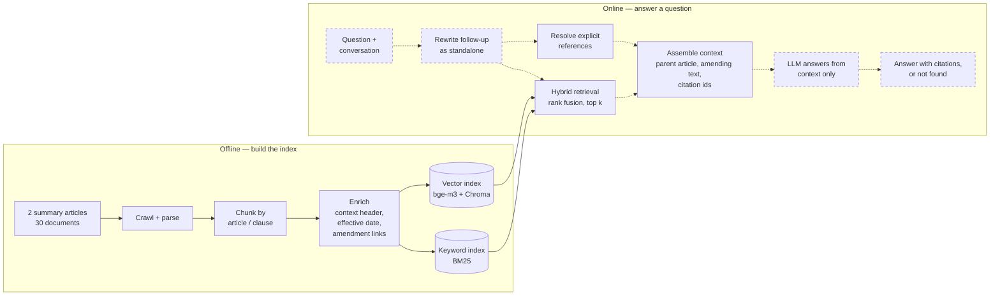

# vn-tax-law-rag

Question-answering agent over Vietnamese tax law (laws, decrees, circulars), built with retrieval-augmented generation and answering with article-level citations.

<!-- Demo link and screenshot go here once there is something to show. -->

## The problem

Vietnamese tax rules are spread across three layers of documents — a law, the decrees that
detail it, and the circulars that guide those — and 2025–2026 brought a wave of new and amending
texts. Answering one practical question ("what do household businesses have to declare?") means
reading several documents and knowing which provision currently applies. This project is also
how I am learning RAG end to end, from crawling and chunking to evaluation.

## What it does

Planned — see Status for what exists today.

- Answers questions about current Vietnamese tax law in Vietnamese.
- Cites the document, article and clause behind every answer, with a link to the source text.
- Says it found nothing rather than guessing when the documents do not cover the question.

## How it works

Solid boxes are built; dashed boxes are planned.



Why it is built this way: chunking in [ADR-0001](docs/adr/0001-chunk-by-legal-structure.md),
retrieval in [ADR-0002](docs/adr/0002-hybrid-retrieval-without-rerank.md). There is no
reranker in the first version: on CPU it took ~20 s per question.

Step by step, with examples from the corpus: [docs/product/architecture.md](docs/product/architecture.md).
All project documents: [docs/README.md](docs/README.md).

1. **Crawl** — `scripts/crawl_index.py` reads the summary article listing current tax documents and
   runs `scripts/crawl_one.py` on each: fetch the page, cache the raw HTML, extract metadata plus
   the full text as ordered blocks.
2. **Chunk** — split along the legal structure (chapter / article / clause), not by token count,
   so each retrieved unit is something a citation can point to; each chunk then gets a context
   header naming its document, chapter, article and clause.
3. **Retrieve** — hybrid keyword + embedding search, because users ask both in prose and by
   document number, and explicit references ("Điều 9 Luật 48/2024") are looked up directly.
   Built: `src.retrieval`, 0.45 s per question (median) on CPU.
4. **Answer** — an LLM answers only from the retrieved articles and cites them. *Not built yet.*
5. **Evaluate** — a hand-written question set with expected answers, key facts and articles,
   scored on retrieval and on the answers. The set (v1, 50 questions and 6 conversations), its
   checker (`python -m src.eval.check`) and the runner (`python -m src.eval.run`) are built; the
   runner scores retrieval today, and the answers once generation exists.

## Data

The corpus is the 30 tax laws, decrees and circulars listed in two summary articles on
luatvietnam.vn:

- [Tổng hợp danh sách luật thuế và nghị định, thông tư thuế mới nhất 2026](https://luatvietnam.vn/thue-phi-le-phi/tong-hop-danh-sach-luat-thue-va-nghi-dinh-thong-tu-thue-moi-nhat-2026-565-110892-article.html) — 27 documents
- [Luật Thuế TNCN mới nhất 2026 và văn bản hướng dẫn](https://luatvietnam.vn/thue-phi-le-phi/tong-hop-van-ban-huong-dan-ve-thue-tncn-moi-nhat-565-96172-article.html) — adds the personal income tax law, decree and circular

Every document, how they relate and what is irregular in them:
[docs/reference/corpus.md](docs/reference/corpus.md). Vietnamese legal terms used throughout:
[docs/reference/glossary.md](docs/reference/glossary.md).

The crawler reads its list from `INDEX_URLS` in `scripts/crawl_index.py`. Vietnamese legal
normative documents are not protected by copyright (Law on Intellectual Property, Article 15),
but the website they are taken from adds its own summaries and annotations. Only the crawler is
published; crawled pages and parsed text stay local (`data/` is gitignored).

## Run it

```bash
git clone <clone url>
cd vn-tax-law-rag
python -m venv .venv
.venv\Scripts\Activate.ps1        # Windows PowerShell; bash: source .venv/bin/activate
pip install -r requirements.txt
cp .env.example .env              # then fill in the real values
python scripts/crawl_index.py        # all listed documents; or crawl_one.py <document-url>
python scripts/rebuild.py            # from the cache: parse, chunk, enrich, index; first run ~82 min on CPU
```

`rebuild.py` runs these steps in order; each can also be run alone:

```bash
python scripts/crawl_index.py        # data/raw/ -> data/processed/ (no request on a full cache)
python -m src.chunking               # data/processed/ -> data/chunks/
python -m src.enrich                 # data/chunks/ -> data/enriched/: header, effective date, amendment links
python -m src.index                  # data/enriched/ -> data/index/: bge-m3 + Chroma and BM25, offline
```

Score the eval set against the built index:

```bash
python -m src.eval.check             # check eval/questions.yaml against the corpus
python -m src.eval.run               # score it; writes eval/results/<date>-<commit>.json
```

## Tests

```bash
pytest
```

## Built with

Python 3.12, requests, BeautifulSoup + lxml; bge-m3 through sentence-transformers on CPU, Chroma,
bm25s; gemini-3.5-flash-lite on the Gemini API free tier.

## Status

Early. The crawler fetches all 30 listed documents; every one has an unbroken run of articles
from Điều 1 to its last article. Chunking (744 articles, 1,286 chunks), the context header,
each chunk's effective date, the amendment links between documents (175) and both indexes
over the chunks (vector and BM25), reference lookup and hybrid retrieval, context assembly, and
eval set v2 are built, with the eval runner scoring retrieval; the agent does not exist yet.
