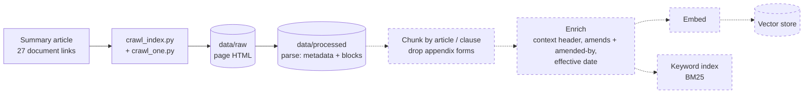
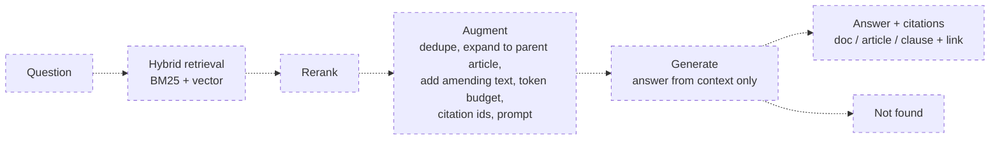

# RAG pipeline — sketch

Draft thinking, not a decision. Solid boxes exist; dashed boxes are planned.

## Offline: build the index



### Notes on the offline steps

- **Summary article.** luatvietnam.vn's list of tax documents in force in 2026. Only links in
  its tables count; one document listed under several tax types is kept once (by document id).
- **Crawl.** One request per document, 3 s apart. The whole page is cached, so parsing can be
  changed and re-run without touching the site again.
- **raw vs processed.** `raw` is the page as downloaded. `processed` is **parsing**, not
  enrichment: it strips the site's UI and keeps only what the source already says — metadata
  from the overview table, and the text as ordered blocks.
- **Chunk.** Unit is the legal structure, not a token count:
  - one article (Điều) per chunk; split by clause (Khoản) only when an article is too long;
  - each chunk keeps its position: document, chapter, article, clause — the citation is built
    from it;
  - article headings are found by text (`^Điều \d+\s*\.`), not the site's CSS classes, which
    do not map cleanly to articles;
  - appendix forms are dropped in the first version: most of the volume, little answer value.
- **Enrich.** Adds what a chunk does not carry on its own:
  - *context header* — a short prefix naming where the chunk sits, built from metadata:
    `[Thông tư 90/2026/TT-BTC — Quy định về đăng ký thuế] [Chương II > Điều 5 > Khoản 2]`.
    A clause like "Trường hợp quy định tại khoản 1 Điều này…" means nothing alone;
  - *amends / amended_by* — see Open questions;
  - *effective date* — paid-only on the site, so read from the document's own
    "Hiệu lực thi hành" article.

  Header and text are stored as separate fields: header + text is what gets indexed, text
  alone is what is shown and cited.
- **Two indexes over the same chunks.** Both are keyed by the same chunk id, so their results
  can be merged.
  - *Embed → vector store*: finds chunks by meaning, for questions in plain language.
  - *BM25*: finds chunks by exact words — document numbers, "Điều 9", legal terms. Vietnamese
    words are often several syllables ("thuế giá trị gia tăng"), so tokenizing by syllable vs
    by word (word segmentation) is a choice to test.

## Online: answer a question



### Notes on the online steps

The three RAG letters map to: **R** = hybrid retrieval + rerank, **A** = augment,
**G** = generate.

- **Question.** Vietnamese, free text. It may name a document or article directly
  ("Điều 9 Luật 48/2024"); see Open questions on handling that before retrieval.
- **Hybrid retrieval.** BM25 and vector search each return their top candidates; the two
  lists are merged into one, typically by rank (reciprocal rank fusion), because their raw
  scores are not on the same scale. Goal here is recall: cast a wide net, ~20–50 chunks.
- **Rerank.** A cross-encoder reads question and chunk *together* and scores relevance, which
  is more accurate than the separate embeddings used in retrieval but too slow to run over the
  whole corpus. Cuts the wide list down to the best few, ~5–10. Goal here is precision.
- **Augment.** Builds what the LLM will read. Each item:
  - *dedupe* — the same text found as a clause and as its article is kept once;
  - *expand to parent article* — a clause hit pulls in its whole article, so "khoản 1 Điều
    này" can be resolved;
  - *add amending text* — a chunk with `amended_by` brings the amending article next to it,
    so the answer uses the current wording;
  - *token budget* — trim to fit the model's context, most relevant first;
  - *citation ids* — each passage gets a short id (e.g. `[TT90/2026-Đ5-K2]`) the LLM must
    quote back, which makes citations checkable;
  - *prompt* — system rules: answer only from the passages, cite every claim, say "not found"
    otherwise, information not advice.
- **Generate.** The LLM writes the answer in Vietnamese from the passages only.
- **Answer + citations.** Citation ids are turned back into document / article / clause and
  a link to the source page. An id the LLM made up, that was not in the context, is a
  detectable error.
- **Not found.** Two triggers: rerank scores all below a threshold (nothing relevant was
  retrieved), or the LLM finds the passages do not answer the question. Saying so is a
  correct answer, not a failure.

## Eval loop

```mermaid
flowchart LR
    qs[Question set<br/>+ expected articles] -.-> run[Run pipeline]
    run -.-> m[recall@k<br/>citation correctness<br/>faithfulness]

    classDef planned stroke-dasharray: 5 5
    class qs,run,m planned
```

## Open questions

- Chunk unit: one article per chunk, split by clause above some length? What length?
- Context header: is the rule-based one enough, or does an LLM-written one (Anthropic's
  "contextual retrieval") measurably help on the eval set?
- BM25 tokenization: syllables, or word-segmented (e.g. underthesea / pyvi)?
- Not-found threshold on rerank score: what value, tuned how?
- Amendments: extract `amends` from the amending text itself ("Sửa đổi khoản 25 Điều 5 của
  Luật …"), then invert it across the corpus to get `amended_by` — the amended document never
  says it was amended. Both directions on the chunk: `amends` makes an amending fragment
  readable, `amended_by` stops an answer from the outdated original. Same edge shape for
  replaces / repeals, at article or clause level, not just document level.
- Query by reference ("Điều 9 Luật 48/2024"): regex lookup before retrieval, or trust BM25?
- Rerank: worth it at 27 documents, or only once eval shows retrieval misses?
- Embedding model with good Vietnamese: bge-m3, multilingual-e5 — compare on the eval set.
