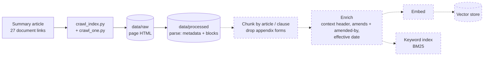
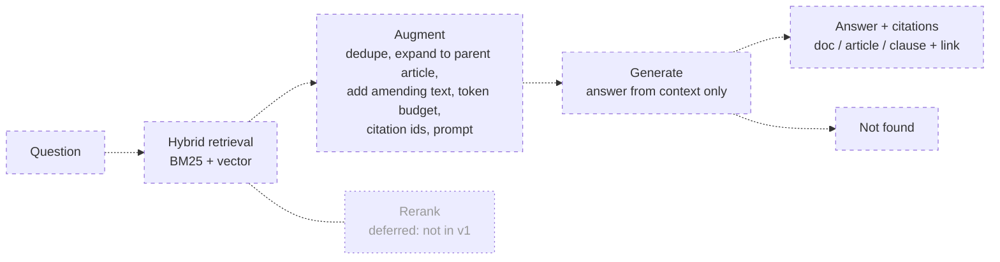

# RAG pipeline — sketch

Draft thinking, not a decision. Solid boxes exist; dashed boxes are planned.

## Offline: build the index



### Notes on the offline steps

- **Summary article.** luatvietnam.vn's list of tax documents in force in 2026. Only links in
  its tables count; one document listed under several tax types is kept once (by document id).
- **Crawl.** One request per document, 3 s apart. The whole page is cached, so parsing can be
  changed and re-run without touching the site again.
- **raw vs processed.** `raw` is the page as downloaded. `processed` is **parsing**, not
  enrichment: it strips the site's UI and keeps only what the source already says — metadata
  from the overview table, and the text as ordered blocks.
- **Chunk.** Unit is the legal structure, not a token count:
  - one article (Điều) per chunk; split by clause (Khoản) when the article is over ~800
    tokens. Measured per article (2026-11-04): p50 532, p75 1,136, p90 2,064, max 8,087
    tokens, so about 37% of articles are split at 800. The split is mainly for retrieval
    precision — a 2k-token article covers several topics — but the largest article is also
    close to bge-m3's 8,192-token limit. Augment pulls the parent article back in when needed.
    800 is a starting point for eval to tune;

    > **Correction, 2026-11-04.** An earlier version of this note gave p50 186, p90 751, max
    > 3,289 "per article" and "about 1 article in 10 split". Those were per-chunk numbers from
    > the benchmark, where articles over 4,000 chars had already been split by clause.
  - each chunk keeps its position: document, chapter, article, clause — the citation is built
    from it;
  - article headings are found by text (`^Điều \d+\s*\.`), not the site's CSS classes, which
    do not map cleanly to articles;
  - appendix forms are dropped in the first version: most of the volume, little answer value.
- **Enrich.** Adds what a chunk does not carry on its own:
  - *context header* — a short prefix naming where the chunk sits, built from metadata:
    `[Thông tư 90/2026/TT-BTC — Quy định về đăng ký thuế] [Chương II > Điều 5 > Khoản 2]`.
    A clause like "Trường hợp quy định tại khoản 1 Điều này…" means nothing alone;
  - *amends / amended_by* — extract `amends` from the amending text itself ("Sửa đổi khoản 25
    Điều 5 của Luật …"), then invert it across the corpus to get `amended_by`: the amended
    document never says it was amended. Both directions go on the chunk — `amends` makes an
    amending fragment readable, `amended_by` stops an answer from the outdated original. Same
    edge shape for replaces / repeals, at article or clause level, not just document level;
  - *effective date* — paid-only on the site, so read from the document's own
    "Hiệu lực thi hành" article.

  Header and text are stored as separate fields: header + text is what gets indexed, text
  alone is what is shown and cited.
- **Two indexes over the same chunks.** Both are keyed by the same chunk id, so their results
  can be merged.
  - *Embed → vector store*: finds chunks by meaning, for questions in plain language.
  - *BM25*: finds chunks by exact words — document numbers, "Điều 9", legal terms. Vietnamese
    words are often several syllables ("thuế giá trị gia tăng"), so tokenizing by syllable vs
    by word (word segmentation) is a choice to test.

## Online: answer a question



### Notes on the online steps

The three RAG letters map to: **R** = hybrid retrieval (+ rerank later), **A** = augment,
**G** = generate.

- **Question.** Vietnamese, free text. It may name a document or article directly
  ("Điều 9 Luật 48/2024"). A regex catches such references first and fetches those chunks
  directly by metadata; hybrid retrieval still runs for the rest of the question. BM25 alone
  is not trusted for this: "Điều 9" appears in hundreds of chunks, and document numbers like
  `48/2024/QH15` are split into fragments by tokenizers.
- **Hybrid retrieval.** BM25 and vector search each return their top candidates; the two
  lists are merged into one, typically by rank (reciprocal rank fusion), because their raw
  scores are not on the same scale. With a reranker this step casts a wide net (~20–50) for the
  reranker to cut; **without one (v1) the fused list is cut directly to the top ~5–10**.
- **Rerank — deferred, not in v1.** Too slow on CPU (Risks checked); added only if eval
  shows the right article is retrieved but ranked too low. What it would do: a cross-encoder reads question and chunk *together* and scores relevance, which
  is more accurate than the separate embeddings used in retrieval but too slow to run over the
  whole corpus. Cuts the wide list down to the best few, ~5–10. Goal here is precision.
- **Augment.** Builds what the LLM will read. Each item:
  - *dedupe* — the same text found as a clause and as its article is kept once;
  - *expand to parent article* — a clause hit pulls in its whole article, so "khoản 1 Điều
    này" can be resolved;
  - *add amending text* — a chunk with `amended_by` brings the amending article next to it,
    so the answer uses the current wording;
  - *token budget* — trim to fit the model's context, most relevant first;
  - *citation ids* — each passage gets a short id (e.g. `[TT90/2026-Đ5-K2]`) the LLM must
    quote back, which makes citations checkable;
  - *prompt* — system rules: answer only from the passages, cite every claim, say "not found"
    otherwise, information not advice.
- **Generate.** The LLM writes the answer in Vietnamese from the passages only.
- **Answer + citations.** Citation ids are turned back into document / article / clause and
  a link to the source page. An id the LLM made up, that was not in the context, is a
  detectable error.
- **Not found.** Two triggers: retrieval scores all below a threshold (rerank score once
  there is a reranker) (nothing relevant was
  retrieved), or the LLM finds the passages do not answer the question. Saying so is a
  correct answer, not a failure.

## Eval loop

```mermaid
flowchart LR
    qs[Question set<br/>+ expected articles] -.-> run[Run pipeline]
    run -.-> m[recall@k<br/>citation correctness<br/>faithfulness]

    classDef planned stroke-dasharray: 5 5
    class qs,run,m planned
```

## Tech stack — proposal

Write the RAG core by hand; use libraries only for the heavy parts (models, indexes). No
LangChain / LlamaIndex in the first version: the point of the project is to understand and
measure each step, and hand-written retrieval code shows that better than framework glue.
Each choice becomes an ADR once settled.

| Step | Proposal | Why / alternative |
|---|---|---|
| Chunk + enrich | Plain Python + regex; `pydantic` chunk schema; JSONL on disk | Legal structure is explicit, no library needed. This is where the project differs from a tutorial. |
| Embed | `BAAI/bge-m3` via `sentence-transformers`, local | Multilingual, good Vietnamese, up to 8k tokens, free. Alternative: `intfloat/multilingual-e5-large` — compare on the eval set. |
| BM25 tokenization | `underthesea` or `pyvi` | Compare against plain syllable tokens. |
| BM25 | `bm25s` | Fast, small. Alternative: `rank_bm25`. |
| Vector store | Chroma, persisted locally | Enough for a few thousand chunks; `chroma_db/` is already gitignored. Alternative: Qdrant — native hybrid search, but a server to run. |
| Hybrid retrieval | Reciprocal rank fusion, hand-written | ~10 lines; no reason to hide it. |
| Rerank | **Deferred — not in v1.** Candidate if added: `BAAI/bge-reranker-v2-m3` | Too slow on CPU (Risks checked). |
| Generate | Keep the scaffold's Gemini default behind a thin interface | Swapping to Claude or another provider is one file. Check current pricing before choosing. |
| Eval | Hand-written recall@k / MRR for retrieval; LLM-as-judge for faithfulness | RAGAS later if useful. Writing the metrics is how you learn what they measure. |
| UI + demo | Streamlit on Hugging Face Spaces | Fast, gives the README a demo link. Alternative: FastAPI + a small frontend. |

### Risks checked

Rough benchmark, 2026-11-03: bge-m3 and bge-reranker-v2-m3 on CPU, over chunks cut from the
crawled corpus (article per chunk, clause split above 4000 chars, appendix cut by a rough regex).
Dev laptop: i7-10610U 4 cores, 16 GB RAM with only ~2 GB free during the run, no GPU.

| Measure | Result |
|---|---|
| Corpus | 1,824 chunks, 564k tokens; per chunk p50 186, p90 751, max 3,289 tokens; ~4 chars/token |
| Per article, unsplit | 638 articles; p50 532, p75 1,136, p90 2,064, max 8,087 tokens |
| Embed corpus | ~93 tokens/s, so ~95 min for the full index (4 and 2 threads alike) |
| Embed one query | 0.25–0.46 s |
| Rerank 20 / 50 pairs | 19–28 s / 65–76 s |
| RAM, both models loaded | ~4 GB |

4 and 2 threads gave the same embed speed, which points at memory pressure rather than compute:
treat these as pessimistic, not as the machine's real speed.

**Risk 1 — local hardware.**
- Indexing is a one-off batch: ~1.5 h worst case is acceptable. Vectors are saved, never
  recomputed per run; a free Colab GPU is the fallback if it has to be re-run often.
- Query embedding is fast enough.
- **Rerank on CPU is not usable interactively** — 20 s for 20 pairs. Options: skip it in v1
  and add it only if eval shows retrieval misses; rerank fewer, shorter inputs (top 10,
  truncated to 256 tokens); a smaller reranker; or a hosted rerank API.

**Risk 2 — Hugging Face Spaces free tier** (CPU Basic: 2 vCPU, 16 GB RAM, 50 GB non-persistent
disk; sleeps after 48 h idle — official docs, see links below).
- RAM fits: ~4 GB for both models against 16 GB.
- The Space only embeds queries and searches a prebuilt index; indexing never runs there.
- Same rerank problem as locally, on 2 vCPU.
- Cold start after sleep: disk is not persistent, so models may be downloaded again on wake —
  a first visitor could wait minutes. Not measured; check when deploying.

Sources: [Spaces overview](https://huggingface.co/docs/hub/spaces-overview),
[Spaces hardware](https://huggingface.co/docs/hub/en/spaces-gpus).

## Open questions

Need the eval set — each is a measurement, not an argument:

- Context header: is the rule-based one enough, or does an LLM-written one (Anthropic's
  "contextual retrieval") measurably help?
- BM25 tokenization: syllables, or word-segmented (e.g. underthesea / pyvi)?
- Embedding model: bge-m3 vs multilingual-e5.
- Not-found threshold: fused rank scores are not calibrated. Starting point: the LLM decides,
  plus a floor on vector similarity, tuned with eval questions the corpus deliberately cannot
  answer.
- Chunk split threshold: is ~800 tokens right? Share of articles split: 59% at 400, 37% at
  800, 30% at 1,000, 18% at 1,500 (issue #12).

Smaller, checkable on the data:

- Does a regex catch every amending phrasing ("Sửa đổi, bổ sung…", "Bổ sung … vào sau …",
  "Thay thế…", "bãi bỏ…")? Run it over the amending documents and read the misses.

Leaning, with the condition that would reopen it:

- Rerank out of v1 (CPU too slow, Risks checked). Reopen if eval shows the right article
  retrieved but ranked below the cut; then choose between fewer/shorter pairs, a smaller
  model, or a hosted API.
