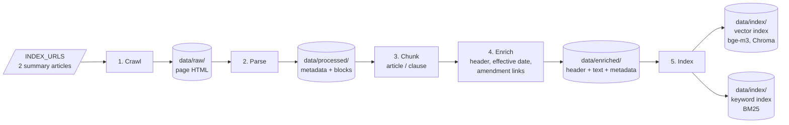
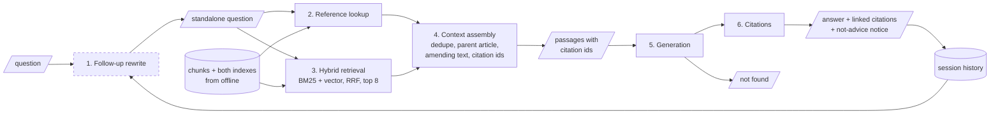

# Architecture — vn-tax-law-rag

How the pipeline works, step by step. The overview diagram is in the root `README.md`
("How it works"); this page follows a document and a question through it.

This page explains; it does not decide. What each step owes is in
[requirements.md](requirements.md), why it is built this way is in [`../adr/`](../adr/README.md),
and both outrank this page. Steps marked **Planned** are not built yet.

## Offline: from source pages to two indexes

Runs once, and again whenever the corpus or the chunking changes. Nothing here runs per
question. Numbers match the sections below; every step is built. Once the pages are cached,
`python scripts/rebuild.py` runs steps 2–5 in one command and makes no network request (NFR-005).

### 1. Crawl — built

`scripts/crawl_index.py` reads two summary articles on luatvietnam.vn (the list is
`INDEX_URLS` in that script) and takes the document links from their tables. A document
listed in both, or under several tax types, is crawled once — 30 documents as of 2026-11-04.
`scripts/crawl_one.py` fetches each page, 3 s apart, and caches it in `data/raw/`, so later
steps can be re-run without touching the site. — FR-CORE-001, NFR-004

### 2. Parse — built

The cached page is reduced to what the document itself says: metadata from the page's overview
table (number, type, issuer, issue date, signer, title) and the text as ordered blocks, in
`data/processed/`. Site menus, ads and buttons are dropped, and so is what the site writes
inside the text: its "Bổ sung" labels on amended provisions and its comment blocks between
provisions (#21). Effective dates are not on the free
page; they come from the text in step 4. — FR-CORE-001

### 3. Chunk — built

Each document is cut along its legal structure, because an answer has to cite one provision:

- one article (Điều) per chunk;
- an article over 1,600 tokens is split into its clauses (Khoản) — 98 of 744 articles,
  since articles run from a few lines to 8k tokens (threshold set by #12);
- only article text is chunked; the heading block, the preamble ("Căn cứ…"), chapter titles,
  the signature block and appendix forms are not.

Every chunk keeps its place — document, chapter, article, clause — and a clause chunk keeps a
link to its parent article. `python -m src.chunking` writes them to `data/chunks/`; the format
is [chunk-schema.md](../reference/chunk-schema.md). — FR-CORE-002,
[ADR-0001](../adr/0001-chunk-by-legal-structure.md)

### 4. Enrich — built

A chunk alone often cannot be understood. Take clause 1 of Article 5 of Circular 90/2026:

> 1. Mã số thuế thực hiện theo quy định tại khoản 1, 2, 3 và 4 Điều 11 Luật số 108/2025/QH15.
> Trường hợp mã số thuế do cơ quan thuế cấp, cấu trúc mã số thuế như sau: …

Nothing in it says it belongs to a circular on tax registration. Enrichment adds:

- **Context header** — where the chunk sits, built from metadata by `python -m src.enrich`
  (exact rules in [chunk-schema.md](../reference/chunk-schema.md)):
  `[Thông tư 90/2026/TT-BTC — Quy định về đăng ký thuế] [Chương I. QUY ĐỊNH CHUNG > Điều 5. Cấu trúc mã số thuế > Khoản 1]`.
  Header + text is what gets indexed; the text alone is what a reader sees in a citation.
  — FR-CORE-003
- **Effective date** — read from the document's own effectiveness article, per chunk, because
  one document can set different dates for different articles: Law 09/2026/QH16 puts
  articles 1–3 in force from 01/01/2026 and the rest from its adoption on 24/04/2026. A date
  that holds for only part of a chunk, an application rule ("áp dụng từ kỳ tính thuế…") and an
  end date are reported rather than guessed; rules in
  [chunk-schema.md](../reference/chunk-schema.md#effective-date). — FR-CORE-004
- **Amendment links** — Law 149/2025/QH15, Article 1, rewrites clause 25 of Article 5 of the
  VAT Law 48/2024/QH15 (the revenue threshold for household businesses). The amending text
  says so; the original does not. So the link is read from the amending side (`amends`) and
  inverted across the corpus (`amended_by`). Without it, retrieval can return the original
  clause and the answer would quote superseded wording. A target outside the corpus is kept
  and marked as such. The corpus holds 175 links, 37 of them onto its own chunks; amendments
  made by documents outside the corpus are not seen
  ([corpus.md](../reference/corpus.md#amendments-from-outside-the-corpus)). Rules in
  [chunk-schema.md](../reference/chunk-schema.md#amendment-links). — FR-CORE-005

### 5. Index — built

`python -m src.index` builds two indexes over the same chunk ids, from header + text:

- **Vector index** — bge-m3 embeddings in a local Chroma collection; finds chunks by meaning.
- **Keyword index** — BM25 over lowercased syllables; finds exact terms such as "mã số thuế"
  or a document number such as `48/2024/QH15`, which stays one token.

Each index holds only ids; everything else is read back from the enriched chunks. The corpus
is embedded once (82 minutes on the dev laptop's CPU) and the vectors are cached by text, so a
rebuild embeds only what changed; the demo only embeds questions. The model loads from the
local cache, with no network request. Format in [index.md](../reference/index.md).
— FR-CORE-006, NFR-005, [ADR-0002](../adr/0002-hybrid-retrieval-without-rerank.md)

## Online: from a question to a cited answer

Runs per question. The three letters of RAG map onto it as: retrieve (steps 1–3),
augment (step 4), generate (steps 5–6). Steps 2 to 6 are built; step 1 is planned.

### 1. Follow-up rewrite — planned

A conversation is kept per session. A follow-up such as "còn hộ kinh doanh thì sao?" has no
topic of its own, so before retrieval it is turned into a standalone question using the earlier
turns. Whether an LLM does the rewrite, or the earlier question is simply added to the search,
is decided by measurement. — FR-CORE-016

### 2. Reference lookup — built

A question that names a provision — "Điều 9 Luật 48/2024", "khoản 2 Điều 9 Luật Thuế GTGT" —
is caught by a pattern and that article is fetched straight from chunk metadata; it takes the
first of the 8 slots. Keyword search is poor at this: "Điều 9" occurs in hundreds of chunks. A
document named without an article ("Nghị định 68/2026 quy định gì …") lifts that document's
chunks in the ranking without hiding the others. A reference to a document outside the corpus
is reported, so the answer can say so. Forms and rules in
[retrieval.md](../reference/retrieval.md). — FR-CORE-007

### 3. Hybrid retrieval — built

The question goes to both indexes. Their result lists are merged by rank — reciprocal rank
fusion — because their raw scores are on different scales, and the top 8 are kept. There is no
reranker in the first version: a cross-encoder took about 20 s per question on CPU. Retrieval
takes 0.45 s per question (median) on the dev laptop, most of it embedding the question.
— FR-CORE-008, [ADR-0002](../adr/0002-hybrid-retrieval-without-rerank.md)

### 4. Context assembly — built

The retrieved chunks become the passages the model reads. Each retrieved chunk brings its whole
parent article, once, so "khoản 1 Điều này" can be resolved; the article's clauses are marked
so a citation can name one (`[1.25]` is clause 25 of passage 1). The amending text of an
amended provision follows the article, and a line in the article says which clause it changes
and how. Articles are ordered by retrieval rank and dropped whole from the lowest-ranked up to
fit 24,000 tokens; the median question's context is about 12,900 tokens. Rules and measurements
in [context.md](../reference/context.md). — FR-CORE-009

### 5. Generation — built

The model answers in Vietnamese from those passages only, as a list of sentences, each with the
ids of the passages it comes from. When a provision it uses carries a link line, the prompt
tells it to say the provision was amended and to cite the amending passage; since it does not
do so reliably, the answerer adds a notice sentence for every amended provision the answer
cites, naming it and its amending provision, built from the link line. If the passages do
not answer the question, the reply is one fixed sentence saying the documents do not cover it;
when it should be given is #16's. The model is `gemini-3.5-flash-lite` on the Gemini API free
tier (ADR-0003), called through one wrapper that keeps under 15 requests a minute, retries and
logs every call ([answer.md](../reference/answer.md)). — FR-CORE-010, FR-CORE-012

### 6. Citations — built, the notice planned

Each citation id becomes document, article and clause with a link to the source page; the
link scrolls to the article where the browser supports text fragments, since the page has no
anchor per article. A citation id that was not in the context is listed apart, never shown as
a source. The note that this is information, not advice, comes with the web interface (#17).
— FR-CORE-011, FR-CORE-013

## Measuring it — built; not-found accuracy and answer relevancy planned

A hand-written eval set, sized per version in acceptance.md (240 questions in version 2), some
unanswerable and some multi-turn, each with its expected answer, key facts and supporting
articles, is run through the whole pipeline by one command, `python -m src.eval.run`. It
records retrieval recall and context precision, answer correctness, citation correctness,
faithfulness, answer relevancy, not-found accuracy, latency and cost. Definitions and targets
are in [acceptance.md](acceptance.md). The set lives in `eval/questions.yaml`;
`python -m src.eval.check` checks it against the corpus while it is written
([eval-set.md](../reference/eval-set.md)).

By default the run stops at retrieval, so it scores recall and context precision and records
the answer metrics as not run. With `--generate` it also answers every standalone question and
an LLM judge scores citation correctness, faithfulness and answer correctness, each run checked
by hand on a sample. Each run writes a results file to `eval/results/`, with
the commit and the configuration, and can be compared with an earlier one
([eval-results.md](../reference/eval-results.md)). — FR-CORE-015
